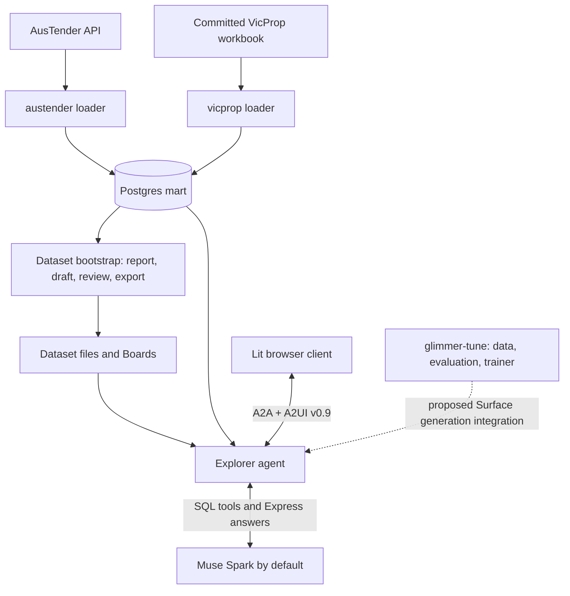

# Glassline

Glassline is a Postgres data explorer that answers plain-English questions with prose, charts,
tables, and metrics. An LLM writes read-only SQL; the server builds the displayed values from
stored query Results. Users can inspect the SQL behind every Visual.

The repository also contains two database projects, a tool for preparing new Datasets, and an
evaluation and fine-tuning harness for teaching Muse Glimmer to generate A2UI Express.
Speed is the primary product requirement, subject to correct numbers.

## Start here

1. Read [Explorer's README](explorer/README.md) for the application, current architecture, and
   local development workflow.
2. Run its stub mode below to see the UI without database or model credentials.
3. Set up [VicProp](vicprop/README.md) for a small database loaded from a committed workbook,
   or [AusTender](austender/README.md) for contract data ingested from an API.
4. Read the [glossary](CONTEXT.md) before changing interaction or rendering code.
5. Consult the [documentation guide](docs/README.md) for specifications, decisions, and evidence.

## Repository map

| Directory | Responsibility | Entry point |
|---|---|---|
| `explorer/` | Dataset-agnostic application: Python agent, Lit client, shared catalog, Dataset configuration, and bootstrap tool | [README](explorer/README.md) |
| `austender/` | AusTender API ingestion, normalisation, and explorer-facing Postgres tables | [README](austender/README.md) |
| `vicprop/` | Victorian suburb median house prices, loaded from a committed Excel workbook | [README](vicprop/README.md) |
| `glimmer-tune/` | Generic A2UI Express data generation, scoring, review, and separate Fireworks trainer | [README](glimmer-tune/README.md) |
| `docs/` | Architecture decisions, local issues, acceptance evidence, experiments, and session history | [README](docs/README.md) |
| `a2ui/` | Optional, git-ignored upstream clone for reference | Upstream documentation; never modify this clone for application work |

This is one Git repository with several independently managed Python and Node projects. There
is no root package installation or root test command. Hidden directories such as `.claude/`
and the ignored `.playwright-mcp/` hold development tooling or session artifacts, rather than
application packages.

## How the pieces fit



The loaders own database writes. Explorer connects with a separate read-only login and sees
only the configured schemas. AusTender and VicProp each have their own database and Compose
service; one running agent serves one selected Dataset. Dataset-specific language and configuration live under
`explorer/datasets/<name>/`, keeping application code independent of either example database.

Explorer has two execution paths. Questions use the model's SQL tool loop and server-expanded
Macros. Boards, their Controls, and Drill-downs use prepared queries without another model
call. An Ask explicitly confirms an interaction that needs the model. See
[Explorer's architecture](explorer/README.md#architecture-and-request-paths).

Glimmer training is a separate project. The proposed Spark-to-Glimmer Surface generation path
is not an installed requirement for running Explorer.

### Using the upstream reference clone

The optional `a2ui/` checkout contains protocol schemas in `specification/`, Python SDKs in
`python/`, browser state/rendering libraries in `typescript/`, canonical catalogs in
`catalogs/`, and sample agents/clients in `samples/`. It also contains implementations for
other client languages that this application does not use. Consult it for API examples and
protocol behavior, with the version pinned by this repository in mind.

The clone has its own upstream README and contributor instructions. Its demo setup is
independent of Glassline's setup. Do not run its workspace install as a prerequisite for Explorer,
modify it for app changes, or depend on its local paths at runtime. Explorer's Python SDKs
come from locked Git dependencies; its browser packages come from npm, and VegaChart is
vendored. Glimmer's catalogs and gallery Seeds are also vendored with provenance.

## Prerequisites

Check everything once before installing project dependencies:

```bash
./check_prereqs.sh
```

The script checks Python 3.13, `uv`, Node.js 20+, npm, Docker with Compose v2
(running daemon), Bash, `curl`, `python3`, and `pgrep`. Install what it reports
missing, then re-run it. Details per project:

- Python 3.13 and `uv` for the Python projects; the trainer requires Python 3.13 specifically.
- Node.js 20 or later and npm for the browser projects. The locked `happy-dom` test dependency
  requires Node 20 or later.
- Docker with Compose v2 for local databases and database tests. Keep the Docker daemon running.
- Git and network access for first-time dependency installation: Python A2UI packages are pinned
  to an upstream Git commit. Tests use stubbed API/model responses rather than live services.
- Bash and `curl` for the Explorer launcher. The bootstrap wrapper also uses `python3` and `pgrep`.

Each Python project has its own `pyproject.toml`, `uv.lock`, and virtual environment. Each Node
project has its own `package.json` and lockfile. Preserve these boundaries: run `uv sync`
and `npm ci` inside each project directory, never from the root.

## First run: no model or database

From the repository root:

```bash
cd explorer/agent
uv sync --locked
cd ../client
npm ci
cd ..
./run.sh
```

Open **http://127.0.0.1:5173**. The launcher runs a stub A2A agent on port **10002** and the
client on port **5173**. Replies use canned data and Express; this verifies the rendering and
transport path rather than question answering. Stop both processes with Ctrl-C.

For real questions, follow the [Explorer setup](explorer/README.md#run-against-a-real-dataset).
It includes database preparation and the root `.env` settings. Model calls use credentials
and may incur charges; ordinary tests and stub mode do not call a model.

## Configuration boundaries

| File | Used by | What it holds |
|---|---|---|
| Root `.env` | Explorer agent and dataset bootstrap | Model credentials, read-only DSNs, selected Dataset, runtime limits |
| `explorer/.env.example` | Setup reference | Committed placeholders and example settings for the root `.env` |
| `austender/.env` | AusTender CLI and Compose | Loader/read-only passwords, database connection, API User-Agent |
| `vicprop/.env` | VicProp CLI and Compose | Loader/read-only passwords, database connection, workbook path |
| Environment supplied to Glimmer commands | Data tools and trainer | `META_API_KEY`, `FIREWORKS_API_KEY`, or scoped `BASETEN_API_KEY` |

Never commit `.env` files or print their contents. Existing environment variables take
precedence over settings loaded by Explorer and the database CLIs. Copy an example only when
the destination does not already exist; edit an existing settings file instead of replacing it.

```bash
# First-time setup only. Later, edit the files instead of re-copying.
cp explorer/.env.example .env          # root settings for the agent + bootstrap
cp austender/.env.example austender/.env  # only if you run the AusTender database
cp vicprop/.env.example vicprop/.env      # only if you run the VicProp database
```

Then fill in passwords, `META_API_KEY`, and (for Explorer) `DATABASE_URL` plus `DATASET_DIR`.
See [Explorer setup](explorer/README.md#run-against-a-real-dataset) for the exact values per Dataset.

## Ports

| Service | Default | Set by |
|---|---|---|
| Explorer client (stub and real) | http://127.0.0.1:5173 | `explorer/run.sh`, `vite.config.ts` (strictPort) |
| Explorer agent (stub and real) | http://127.0.0.1:10002 | `AGENT_PORT` in the environment / root `.env` |
| Bootstrap server (Settings' API) | http://127.0.0.1:8765 | `explorer/run.sh --real` with `EXPLORER_DATA_DIR`, or `uv run python -m explorer_bootstrap serve [--port PORT]`; `BOOTSTRAP_PORT` |
| Glimmer review UI | http://127.0.0.1:8767 | `python -m a2ui_eval.review --port 8767` (server default 8765 if omitted) |
| AusTender Postgres | localhost:5434 | `austender/.env`, `austender/docker-compose.yml` |
| VicProp Postgres | localhost:5435 | `vicprop/.env`, `vicprop/docker-compose.yml` |

`explorer/run.sh` refuses to start if something already serves the agent URL or a different
server holds the bootstrap port: stop the previous server first.

## Build and test entry points

Run each row from its listed directory after installing that project's dependencies.
Install step first (one line per project):

```bash
# Python projects (run inside each directory)
cd explorer/agent && uv sync --locked && cd ../..                  # explorer agent
cd explorer/bootstrap/server && uv sync --locked && cd ../../..    # bootstrap server
cd austender && uv sync && cd ..                                   # austender
cd vicprop && uv sync && cd ..                                     # vicprop
cd glimmer-tune && uv sync --locked && cd trainer && uv sync --locked && cd ../..  # harness + trainer

# Node projects (run inside each directory)
cd explorer/client && npm ci && cd ../..            # explorer client
cd glimmer-tune/review && npm ci && cd ../..       # review UI (build once before serving)
```

| Directory | Check | Requirements |
|---|---|---|
| `explorer/agent/` | `uv run pytest` | Docker; real-database tests excluded by default |
| `explorer/client/` | `npm test` and `npm run build` | `uv` on PATH for the stub-agent interop test |
| `explorer/bootstrap/server/` | `uv run pytest` | Docker |
| `austender/` | `uv run pytest` | Docker; API transport stubbed |
| `vicprop/` | `uv run pytest` | Docker; generated test workbooks and committed source workbook |
| `glimmer-tune/` | `uv run pytest -n auto --dist loadgroup -m 'not slow'` (fast tier; full suite without `-m`) | Local scorer/data tests; no model calls |
| `glimmer-tune/trainer/` | `uv run pytest` | Separate trainer environment; remote SDK stubbed |
| `glimmer-tune/review/` | `npm test` and `npm run build` | Node/npm; build before serving the review UI |

## Run each module

Work through this list top-down the first time: databases before Explorer, Explorer stub
before Explorer real, bootstrap after a database exists, Glimmer last (it never touches
a database).

### 1. VicProp database (small, offline)

```bash
cd vicprop
cp .env.example .env   # first time only; then set passwords
# set LOADER_PASSWORD and EXPLORER_RO_PASSWORD in vicprop/.env
docker compose up -d --wait
uv sync
uv run vicprop migrate
uv run vicprop load     # committed workbook; idempotent
uv run vicprop stats
```

Full reference: [VicProp README](vicprop/README.md#setup-and-load).

### 2. AusTender database (needs API access)

```bash
cd austender
cp .env.example .env   # first time only; then set passwords and INGEST_USER_AGENT
docker compose up -d --wait
uv sync
uv run austender migrate
uv run austender fetch-month 2026-09   # one bounded month for a first load
uv run austender rebuild
uv run austender stats
```

The full historical backfill (`backfill`, ~2.5-3 h) is deliberate and separate; see the
[AusTender README](austender/README.md#starting-the-full-backfill). Never run it unasked.

### 3. Explorer with stub data (no model, no database)

```bash
cd explorer/agent && uv sync --locked && cd ../client && npm ci && cd ..
./run.sh   # stub agent on :10002 + client on :5173
```

Open http://127.0.0.1:5173. Ctrl-C stops both. This verifies transport/rendering only.

### 4. Explorer against a real Dataset (model + database)

```bash
# Root .env first (first time only): cp explorer/.env.example .env, then edit.
# VicProp example: DATABASE_URL=postgresql://explorer_ro:<password>@localhost:5435/vicprop
#                   DATASET_DIR=datasets/vicprop, plus META_API_KEY and MODEL.
# AusTender example: port 5434, database austender, DATASET_DIR=datasets/austender.
cd explorer
./run.sh --real
```

Or run the pieces separately: `uv run python -m explorer_agent` in `explorer/agent/` plus
`npm run dev` in `explorer/client/`. Startup refuses write-capable logins and bad
Dataset/Board config. Model calls may incur charges.

### 5. Bootstrap (prepare a new Dataset)

Needs a database with a read-only login. Report is model-free; draft/boards call the model,
ask for confirmation first and log each call's cost.

In the browser, use the explorer's Settings: set `EXPLORER_DATA_DIR` (absolute, outside the
repo) and a `<NAME>_DATABASE_URL` read-only login per database in the root `.env`, then:

```bash
cd explorer
./run.sh --real      # then open http://127.0.0.1:5173/#/settings and "Add a Workspace"
```

CLI workflow with Boards (from `explorer/bootstrap/server/`):

```bash
uv run python -m explorer_bootstrap report --schemas mart --json report.json
uv run python -m explorer_bootstrap draft --schemas mart --out draft.json
uv run python -m explorer_bootstrap verify --draft draft.json
uv run python -m explorer_bootstrap boards --draft draft.json --out boards.json
uv run python -m explorer_bootstrap export --draft draft.json --boards boards.json --name my_dataset --target toml
```

Full reference: [Bootstrap README](explorer/bootstrap/README.md).
The browser UI covers Connect → Report → Review; Boards stay CLI/API-only.

### 6. Glimmer-tune harness and trainer (no database)

```bash
cd glimmer-tune && uv sync --locked
uv run pytest -n auto --dist loadgroup -m 'not slow'   # fast tier; no model calls
uv run python -m a2ui_eval.data_cli lint --gallery    # inspect existing data
uv run python -m a2ui_eval.data_cli export-dev
cd trainer && uv sync --locked && uv run pytest && cd ..  # separate env
cd review && npm ci && npm run build && cd ..         # build review UI once
uv run python -m a2ui_eval.review --port 8767         # open http://127.0.0.1:8767
```

`export --train` has no train set until Approach v2 builds the distilled one. `train --launch`
and `sample` spend money and need explicit approval; see the
[Glimmer README](glimmer-tune/README.md#trainer-and-checkpoint-scoring).
Model boundaries (Spark Open teacher/judge, hosted models eval-only) are in
[AGENTS.md](glimmer-tune/AGENTS.md) and the Glimmer README.

## Documentation and change workflow

READMEs explain how to navigate and run the current code. Specifications define behavior, and
dated amendments can supersede their earlier sections. ADRs explain the choices. A proposal
or approved design is not by itself evidence that implementation is complete.

Read the applicable `AGENTS.md` before editing a project. New Explorer behavior starts with a
spec amendment or sub-spec and an ADR where a decision is needed. Tests must not call real
models or external data services. Keep the shared A2UI SDK pin aligned across Explorer and
Glimmer, and preserve vendored Apache-2.0 notices.

Issues live in [`docs/issues/`](docs/issues/), since the repository has no remote issue tracker.
Use Conventional Commits with the template in [`.gitmessage`](.gitmessage).

## License and attribution

The code is licensed under the [Apache License 2.0](LICENSE). Third-party material and data
credits are in [NOTICE](NOTICE). In particular:

- The `vicprop/` source workbook is from the Victorian Government
  ([land.vic.gov.au](https://land.vic.gov.au)) under
  [CC BY 3.0 AU](https://creativecommons.org/licenses/by/3.0/au/).
- The `austender/` database holds contract notices from
  [AusTender](https://www.tenders.gov.au), Department of Finance, Commonwealth of Australia,
  under CC BY 3.0 AU. Approach to Market material is excluded from that licence and isn't used.
