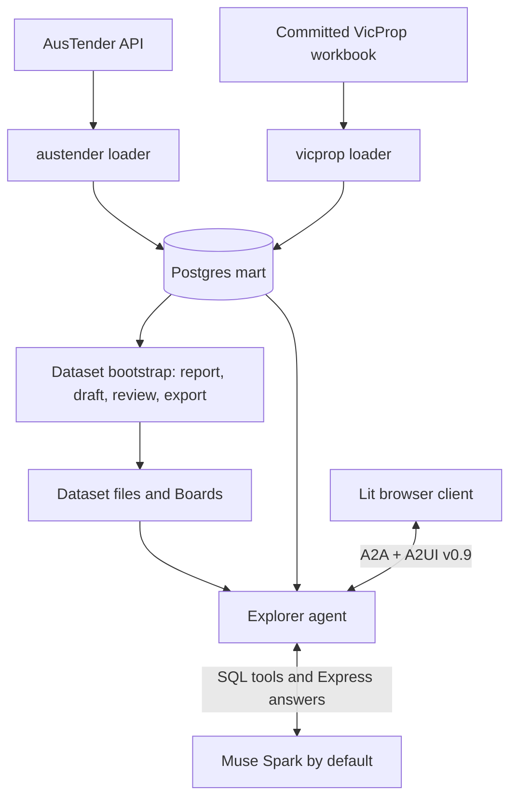

# Glassline

Live service: https://52.70.126.131.sslip.io
For the password e-mail me at williamvoor at gmail 
or Discord oa23057
(I had to put the service behind auth to avoid bots)

Glassline is a Postgres data explorer that answers plain-English questions with prose, charts,
tables, and metrics. An LLM writes read-only SQL; the server builds the displayed values from
stored query Results. Users can inspect the SQL behind every Visual.

The repository also contains two database projects, a tool for preparing new Datasets, and an
evaluation and fine-tuning harness for teaching Muse Glimmer to generate A2UI Express.
Speed is the primary product requirement, subject to correct numbers.

## Start here

1. Read [Explorer's README](explorer/README.md) for the application, current architecture, and
   local development workflow.
2. Set up [VicProp](vicprop/README.md) for a small database loaded from a committed workbook,
   or [AusTender](austender/README.md) for contract data ingested from an API.
3. Run the explorer as described below (it needs a database and model credentials).
4. Read the [glossary](CONTEXT.md) before changing interaction or rendering code.
5. Consult the [documentation guide](docs/README.md) for specifications, decisions, and evidence.

## Repository map

| Directory | Responsibility | Entry point |
|---|---|---|
| `explorer/` | Dataset-agnostic application: Python agent, Lit client, shared catalog and bootstrap tool | [README](explorer/README.md) |
| `austender/` | AusTender API ingestion, normalisation, and explorer-facing Postgres tables | [README](austender/README.md) |
| `vicprop/` | Victorian suburb median house prices, loaded from a committed Excel workbook | [README](vicprop/README.md) |
| `glimmer-tune/` | Generic A2UI Express data generation, scoring, review, and separate Fireworks trainer | [README](glimmer-tune/README.md) |
| `datasets/` | Owner’s committed deployment Datasets, separate from the application | [Dataset maintenance](explorer/README.md#add-or-maintain-a-dataset) |
| `docs/` | Architecture decisions, local issues, acceptance evidence, experiments, and session history | [README](docs/README.md) |
| `a2ui/` | Optional, git-ignored upstream clone for reference | Upstream documentation; never modify this clone for application work |

This is one Git repository with independently managed Python and Node projects. Hidden
tooling directories hold development configuration and session artifacts.

## How the pieces fit



The loaders own database writes. Explorer connects with a separate read-only login and sees
only the configured schemas. AusTender and VicProp each have their own database and Compose
service. The explorer serves the Workspaces in `EXPLORER_DATA_DIR` and saves their Conversations
(there is one mode). Dataset-specific language and configuration live under
`datasets/<name>/` at the repo root (the owner's deployment data), keeping application code independent of either example database.

Explorer has two execution paths. Questions use the model's SQL tool loop and server-expanded
Macros. Boards, their Controls, and Drill-downs use prepared queries without another model
call. An Ask explicitly confirms an interaction that needs the model. See
[Explorer's architecture](explorer/README.md#architecture-and-request-paths).

Glimmer training is a separate project. The proposed serving integration was stopped;
Explorer’s configured answer model continues to write its Surfaces.

The optional `a2ui/` clone is reference-only. Runtime SDKs are locked dependencies;
VegaChart, Glimmer catalogs, and gallery Seeds are vendored with provenance.

## Prerequisites

Run `./check_prereqs.sh` to check Python 3.13, `uv`, Node.js 20+, npm, Docker/Compose,
and shell helpers. Docker is needed for database setup and tests.
Initial dependency installation needs Git and network access.

Each Python/Node project has its own dependencies and lockfile. Install inside the relevant
project directory; there is no root install or test command.

## First run

From the repository root:

```bash
cd explorer/agent
uv sync --locked
cd ../client
npm ci
cd ..
./run.sh
```

`run.sh` needs the root `.env` with a model key and `EXPLORER_DATA_DIR`: follow the
[Explorer setup](explorer/README.md#run) first. It starts the agent on port **10002**, the
bootstrap server (Settings) on **8765** and the client on **5173**; open
**http://127.0.0.1:5173**. There is one mode, Workspaces with Settings. Stop all three
with Ctrl-C. Model calls use credentials and may incur charges; ordinary tests do not call a model.

## Configuration boundaries

| File | Used by | What it holds |
|---|---|---|
| Root `.env` | Explorer agent and dataset bootstrap | Model credentials, `EXPLORER_DATA_DIR`, read-only DSNs, runtime limits |
| `explorer/.env.example` | Setup reference | Committed placeholders and example settings for the root `.env` |
| `austender/.env` | AusTender CLI and Compose | Loader/read-only passwords, database connection, API User-Agent |
| `vicprop/.env` | VicProp CLI and Compose | Loader/read-only passwords, database connection, workbook path |
| Environment supplied to Glimmer commands | Data tools and trainer | `META_API_KEY`, `FIREWORKS_API_KEY`, or scoped `BASETEN_API_KEY` |

Never commit `.env` files or print their contents. Existing environment variables take
precedence over settings loaded by Explorer and the database CLIs. Copy an example only when
the destination does not already exist; edit an existing settings file instead of replacing it.

```bash
# First-time setup only. Later, edit the files instead of re-copying.
cp explorer/.env.example .env          # root settings for the agent + bootstrap
cp austender/.env.example austender/.env  # only if you run the AusTender database
cp vicprop/.env.example vicprop/.env      # only if you run the VicProp database
```

Fill in credentials and follow the [Explorer setup](explorer/README.md#run) or the
[Workspace setup](explorer/bootstrap/README.md#setup-and-browser-workflow). The explorer needs
`EXPLORER_DATA_DIR` and named database logins (`<NAME>_DATABASE_URL`). To use your own database,
see [Add an existing Postgres database](explorer/bootstrap/README.md#add-an-existing-postgres-database).

## Ports

| Service | Default | Set by |
|---|---|---|
| Explorer client | http://127.0.0.1:5173 | `explorer/run.sh`, `vite.config.ts` (strictPort) |
| Explorer agent | http://127.0.0.1:10002 | Exported `AGENT_PORT` for `run.sh`; root `.env` also works for direct agent startup |
| Bootstrap server (Settings' API) | http://127.0.0.1:8765 | `explorer/run.sh`; exported `BOOTSTRAP_PORT` |
| Glimmer review UI | http://127.0.0.1:8767 | `python -m a2ui_eval.review --port 8767` (server default 8765 if omitted) |
| AusTender Postgres | localhost:5434 | `austender/.env`, `austender/docker-compose.yml` |
| VicProp Postgres | localhost:5435 | `vicprop/.env`, `vicprop/docker-compose.yml` |

`explorer/run.sh` refuses to start if something already serves the agent URL or a different
server holds the bootstrap port: stop the previous server first.

## Build and test entry points

Run each row from its listed directory after installing that project's dependencies.

| Directory | Check | Requirements |
|---|---|---|
| `explorer/agent/` | `uv run pytest` | Docker; real-database tests excluded by default |
| `explorer/client/` | `npm test` and `npm run build` | `uv` on PATH for the stub-agent interop test |
| `explorer/bootstrap/server/` | `uv run pytest` | Docker |
| `austender/` | `uv run pytest` | Docker; API transport stubbed |
| `vicprop/` | `uv run pytest` | Docker; generated test workbooks and committed source workbook |
| `glimmer-tune/` | `uv run pytest -n auto --dist loadgroup -m 'not slow'` (fast tier; full suite without `-m`) | Local scorer/data tests; no model calls |
| `glimmer-tune/trainer/` | `uv run pytest` | Separate trainer environment; remote SDK stubbed |
| `glimmer-tune/review/` | `npm run build` | Node/npm; rendering is tested by the Python eval suite |

## Continuous integration

[GitHub Actions CI](.github/workflows/ci.yml) runs only when a pull request is opened,
reopened, or updated. Independent jobs test all seven Python projects, test and build the Explorer
client (including transport against the test-only stub agent), and build the Glimmer review UI
before running the full eval suite with Chromium. Database tests use disposable
Testcontainers Postgres 18 instances; `live_db` tests remain manual. The optional upstream
clone is not checked out, so its reference-only comparison test is skipped.

CI uses Python 3.13, Node 22, cached dependency downloads, `uv sync --locked`, and `npm ci`.
It needs no repository secrets, loaded datasets, or model credentials. Dependency and browser
installation downloads packages; tests use stubs and local services. New commits cancel
older runs for the same pull request. Historical spike projects are outside CI.

Open or update a pull request on GitHub to start CI. If Actions is disabled for the repository, enable
it under **Settings → Actions → General**. Required pull-request checks can then be selected
in the repository's branch rules after the first run.

## Documentation and change workflow

READMEs explain how to navigate and run the current code. Specifications define behavior, and
dated amendments can supersede their earlier sections. ADRs explain the choices. A proposal
or approved design is not by itself evidence that implementation is complete.

Read the applicable `AGENTS.md` before editing a project. New Explorer behavior starts with a
spec amendment or sub-spec and an ADR where a decision is needed. Tests must not call real
models or external data services. Keep the shared A2UI SDK pin aligned across Explorer and
Glimmer, and preserve vendored Apache-2.0 notices.

Issues live in [`docs/issues/`](docs/issues/), kept with the code rather than in GitHub's tracker.
Use Conventional Commits with the template in [`.gitmessage`](.gitmessage).

## License and attribution

The code is licensed under the [Apache License 2.0](LICENSE). Third-party material and data
credits are in [NOTICE](NOTICE). In particular:

- The `vicprop/` source workbook is from the Victorian Government
  ([land.vic.gov.au](https://land.vic.gov.au)) under
  [CC BY 3.0 AU](https://creativecommons.org/licenses/by/3.0/au/).
- The `austender/` database holds contract notices from
  [AusTender](https://www.tenders.gov.au), Department of Finance, Commonwealth of Australia,
  under CC BY 3.0 AU. Approach to Market material is excluded from that licence and isn't used.
