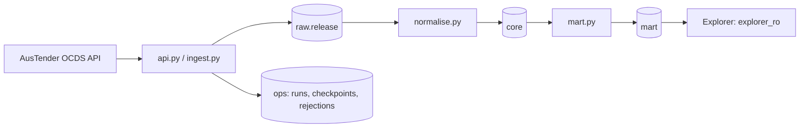

# austender

Australian Commonwealth contract notices (AusTender OCDS API) in Postgres 18, built for the explorer's
LLM agent. `SPEC.md` is the source of truth. Python 3.13, `uv`, `httpx`, `psycopg` 3, plain SQL migrations.

Schemas: `raw` (releases as received), `core` (normalised), `mart` (what the explorer reads), `ops`
(runs, checkpoints, rejected releases, applied migrations). `core` and `mart` are a pure function of
`raw`: `rebuild` from the same raw gives identical tables.

## Architecture and boundaries



The loader writes the database; Explorer reads a curated `mart` schema. There is no model or
UI in this package. Dataset notes and starter questions belong in
[`../datasets/austender/`](../datasets/austender/), while the table/column
descriptions are SQL comments in this project's migrations.

`fetch-month` appends raw releases. It does not refresh the explorer-facing tables: run
`rebuild` after ingestion. Rebuilding uses stored raw releases rather than calling the API.
There is no automatic incremental update daemon. See [SPEC.md](SPEC.md) for source semantics
and [AGENTS.md](AGENTS.md) for change rules.

## Prerequisites

Install Python 3.13, `uv`, and Docker with Compose v2. Keep Docker running for setup and
database tests. Initial dependency/image installation needs network access. Live ingestion
also needs access to the public AusTender API; tests stub that transport.

## Setup

```bash
cd austender
cp .env.example .env          # set LOADER_PASSWORD, EXPLORER_RO_PASSWORD, INGEST_USER_AGENT (never commit .env)
docker compose up -d --wait   # Postgres 18 on host port 5434, named volume austender_pgdata
uv sync
uv run austender migrate      # creates roles austender_loader and explorer_ro, applies migrations
```

Run this block from the repository root; subsequent commands assume `austender/` as the
working directory. Copy `.env.example` only for first-time setup. If `.env` already exists,
edit it instead. This is `austender/.env`, separate from the root `.env` used by Explorer.

At this point the schema exists but has no contract data. To load one month deliberately:

```bash
uv run austender fetch-month 2026-09
uv run austender rebuild
uv run austender stats
```

The fetch calls the live API. Expect `stats` to show raw releases, a completed checkpoint,
and populated `core`/`mart` tables after rebuilding. This example is a bounded first load;
the full historical backfill below is a separate operation. `docker compose stop` stops
the local database while retaining its volume.

`INGEST_USER_AGENT` is required for any command that calls the API (it fails fast if unset). Use something
descriptive with a contact address, e.g. `glassline-austender/0.1 (research; you@example.org)`.

## Configuration

The CLI loads `austender/.env` without overriding existing environment variables.

| Variable | Default / purpose |
|---|---|
| `POSTGRES_HOST`, `POSTGRES_PORT`, `POSTGRES_DB` | `localhost`, `5434`, `austender` |
| `LOADER_PASSWORD` | Password for `austender_loader`, also used to initialise Compose's database |
| `EXPLORER_RO_PASSWORD` | Password assigned to `explorer_ro` by `migrate` |
| `INGEST_USER_AGENT` | Required for API calls; descriptive application/contact string |
| `INGEST_MIN_INTERVAL_MS` | `1000`; values below 1000 are raised to the required floor |

Compose initialises its database credentials when the volume is first created. Changing a
password in `.env` alone does not change an existing database role's password. Coordinate
role changes with the database and the root Explorer DSN rather than deleting the volume.

## Commands

| Command | What it does |
|---|---|
| `uv run austender migrate` | Create/update roles, apply pending migrations in `migrations/` |
| `uv run austender fetch-month 2026-09` | Fetch one UTC month (`contractPublished`) into `raw`, then checkpoint it |
| `uv run austender backfill --from 2013-01 --to 2026-09 [--resume]` | `fetch-month` for each month, oldest first |
| `uv run austender rebuild` | Rebuild `core` and `mart` from `raw` in one transaction |
| `uv run austender stats` | Row counts, latest checkpoint, rejected count |
| `uv run pytest` | Tests (need Docker for the Postgres 18 Testcontainers; no network) |

### Starting the full backfill

It is deliberately not part of setup. About 150 months from 2013-01, at roughly 45-70 pages and about one
minute per month (requests are at least 1 s apart), so around 2.5 to 3 hours. Run it in a terminal that
survives, then rebuild:

```bash
uv run austender backfill --from 2013-01 --to 2026-09
uv run austender backfill --from 2013-01 --to 2026-09 --resume   # after an interruption: skips completed months
uv run austender rebuild
```

Or run `./backfill.sh` (inside `tmux`), which does all of the above from 2013-01 to the last complete UTC
month, keeps a Mac awake, and logs to `logs/` (git-ignored). `./backfill.sh 2020-01 2020-12` sets the range.

A month is checkpointed only after all its pages are stored; an interrupted month is fetched again and
already-stored releases are skipped. A release id seen again with a different payload is recorded in
`ops.rejected_release` and the stored row is left unchanged. The latest month is incomplete until it ends,
so re-run it later (it is idempotent) and rebuild.

## How the explorer connects

Read-only role `explorer_ro` has `SELECT` on schema `mart` only (tables created later included) and
`default_transaction_read_only = on`. It cannot see `raw`, `core` or `ops`, create temp tables or use
schema `public`. Its real write barrier is the missing privileges, so the explorer should still open
`READ ONLY` transactions.

```
postgresql://explorer_ro:<password>@localhost:5434/austender
```

Put that value in `AUSTENDER_DATABASE_URL` in the repository root `.env` and list a Workspace
with `dataset_dir = "datasets/austender"` and `connection = "austender"` in
`$EXPLORER_DATA_DIR/workspaces.toml`, and a Connection `austender` with
`url_env = "AUSTENDER_DATABASE_URL"` in `$EXPLORER_DATA_DIR/connections.toml` (or pick the
variable in Settings, which writes the Connection). URL-encode special characters in the password. Then follow
[Explorer's setup](../explorer/README.md#run).

The Data dictionary comes from `mart` table/column comments, with any Dataset Comment overlay
taking precedence. To inspect the database comments:

```sql
SELECT c.relname, obj_description(c.oid, 'pg_class') AS table_comment,
       a.attname, col_description(c.oid, a.attnum) AS column_comment
FROM pg_class c JOIN pg_namespace n ON n.oid = c.relnamespace
LEFT JOIN pg_attribute a ON a.attrelid = c.oid AND a.attnum > 0 AND NOT a.attisdropped
WHERE n.nspname = 'mart' AND c.relkind = 'r' ORDER BY 1, a.attnum;
```

### In explorer tests

```python
from austender.testing import build_test_db
build_test_db(dsn)   # dsn: superuser DSN of an EMPTY database (e.g. Testcontainers)
```

This creates the roles, migrates, loads the hand-written seed releases (`tests/seed/`) and rebuilds `core`
and `mart`. Afterwards `explorer_ro` / password `explorer_ro` (override with `explorer_ro_password=`) can
read `mart`. Add the package as an editable path dev-dependency; it needs only `httpx`, `psycopg` and `tzdata`.
`tests/seed/expected.py` has the hand-computed totals.

## Rules the mart enforces for you

- `mart.contract` has every notice, cancelled ones included, flagged `is_cancelled`. Cancelled notices keep
  their full value in the source, so spend questions should use `mart.contract_supplier` or the `*_fy`
  summary tables, which exclude them.
- A multi-supplier contract's current value is split equally across its suppliers (`value_share`), so
  summing that column across contract-supplier rows does not double count.
- Current value is the highest-numbered non-cancelled amendment's value (skipping amendments without a
  value), else the original. Amendments are
  full snapshots; the API gives them no date, so none is stored.
- Dates are `Australia/Canberra`; financial years run July to June (`2024-25`).
- Suppliers are keyed by valid ABN, else `name:` plus the normalised name. A withheld name ("Name
  Withheld") without an ABN gets `withheld:<notice_id>`, so placeholders never merge into one supplier.
- `rebuild` empties and refills `mart` with `DELETE` in one transaction, so the explorer keeps reading the
  previous data until it commits.

## Mart tables

| Table | Grain and intended use |
|---|---|
| `mart.contract` | One contract notice, including cancelled notices; notice-level details and amendment counts |
| `mart.contract_supplier` | One non-cancelled contract × supplier; use `value_share` for attributed totals |
| `mart.supplier` | Supplier identity and aggregate totals |
| `mart.agency` | Agency identity and aggregate totals |
| `mart.supplier_fy` | Supplier totals by financial year |
| `mart.agency_fy` | Agency totals by financial year |
| `mart.supplier_agency_fy` | Supplier × agency totals by financial year |

Prefer the summary tables for matching aggregate questions. Do not sum `current_value` after
joining a contract to multiple suppliers; sum the allocated `value_share`. Values are AUD as
published, with no currency conversion. Financial year follows the original notice's Canberra
publish date, not an amendment's republishing timestamp.

## Testing and changes

From `austender/`:

```bash
uv run pytest
uv run pytest tests/test_api.py
```

Tests use `httpx.MockTransport` and injected sleeps for API behavior, and Testcontainers
Postgres 18 for roles, migrations, normalisation, mart totals, and idempotence. They do not
call the public API or a model. The disposable test database is separate from the Compose
database; a local backfill is unnecessary for tests.

For migration, comment-budget and seed rules, see [AGENTS.md](AGENTS.md). Preserve the
`build_test_db(dsn)` integration helper used by Explorer’s tests.

## Troubleshooting

| Symptom | Check |
|---|---|
| Authentication or connection failure | Healthy Compose container, port 5434, and loader password matching the existing role |
| API command rejects configuration | Set `INGEST_USER_AGENT`; this is not needed for local rebuilds/tests |
| Raw rows exist but Explorer sees no data | Run `rebuild`, then inspect `stats` |
| Interrupted ingestion | Re-fetch the month, or use `backfill --resume`; stored identical releases deduplicate |
| Rejected release count rises | Inspect `ops.rejected_release` as the loader; a known release ID changed payload and the stored original was retained |
| Migration checksum mismatch | Restore the applied migration and add a new migration for the intended change |
| Explorer rejects the login | Root `.env` must use `explorer_ro`, not `austender_loader` |

## Data licence and attribution

Contract notices come from [AusTender](https://www.tenders.gov.au), Department of Finance,
Commonwealth of Australia, licensed under
[CC BY 3.0 AU](https://creativecommons.org/licenses/by/3.0/au/). The licence excludes the
Commonwealth Coat of Arms and Approach to Market (ATM) material, which is copyright. This project
loads contract-notice data only. Keep it that way: do not ingest or republish ATM material.
The tables here reshape the notices; that reshaping is ours, not the Commonwealth's. Licence questions
go to the AusTender Administrator, tenders@finance.gov.au. Credits for the whole repo are in the root
`NOTICE`.
