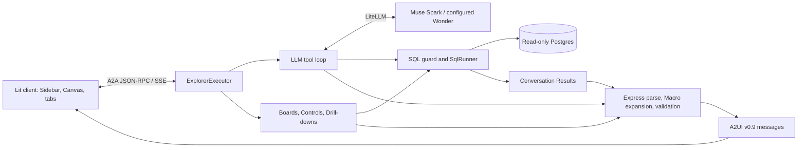

# Explorer

Explorer answers plain-English questions about a Postgres Dataset with prose and generated
charts, tables, and metrics. It also supports an Explorer Board as a landing page, Entity
Boards opened from rows, Controls that re-query a Board in place, and Drill-downs into results.
The client keeps an investigation log and tabs for the views opened during a Conversation.

The central rule is [ADR 0001](../docs/adr/0001-data-reaches-the-screen-only-through-macros.md):
the model refers to stored Results instead of retyping data into the UI. Server-side Macros
produce Visuals and expose their SQL. `Cite` placeholders insert database values into prose.
Bare numbers in model-written prose are warned about rather than universally rejected, since
years and phrases such as “top 10” are also numbers.

## Reading order and status

Start with this README and the [glossary](../CONTEXT.md), then use [SPEC.md](SPEC.md) for the
behavioral contract. Later dated amendments supersede earlier sections. In particular, §18
updates the original chat architecture with Boards, Controls, Entity Boards, and investigation
tabs. [BUILD_PROMPT.md](BUILD_PROMPT.md) is the original brief; the spec takes precedence.

The working tree contains the question-answering path, Actions and Drill-downs, Board runtime,
Controls, Entity Boards, and bootstrap Board drafting/checking through its Python library,
CLI, and HTTP API. The bootstrap browser UI still follows Connect → Report → Review and does
not yet expose the Boards step. Runtime model drafting of missing Entity Boards is a later
slice. The Spark/Glimmer split in §19 and ADR 0031 is a draft, not an implemented serving mode.

## Architecture and request paths



### A typed question

1. The browser sends the question with its A2A context and supported catalog ID. The server
   creates or resumes an in-memory Conversation.
2. The model receives the A2UI rules/catalog, generic instructions, and Dataset context in a
   stable cached prefix, followed by conversation history. The Data dictionary comes from
   database comments with an optional Comment overlay.
3. The model calls `list_tables`, `describe_table`, or `run_sql`. The schema is already in the
   prompt, so a typical answer needs a SQL call and an answer call. Independent tool queries
   can run concurrently.
4. `SqlRunner` guards and executes the SQL. Results receive IDs such as `r1`, and only a
   bounded preview is sent back to the model.
5. The model returns prose plus `<a2ui>…</a2ui>` Express. `UiPipeline` parses it, expands Macros
   against the Results, rewrites Surface IDs, and validates the catalog and properties. A
   bounded Repair loop can correct invalid UI using the existing Results.
6. A2A carries prose and A2UI messages to Lit. Progress events stream while the work runs;
   Express itself is compiled as a complete reply rather than incrementally rendered.

### Boards and interactions

A Board is Dataset configuration: named parameterised SQL queries, optional Controls, and an
Express layout of Macro calls. Startup checks its queries and referenced columns. Rendering
runs the queries and expands the layout without calling the model; query concurrency, row
caps, and an in-memory cache bound the work.

- The Explorer Board has no entity key and opens as the first tab when configured.
- An Entity Board is keyed on a column in a clicked row and shows that entity across the
  Dataset. Its scope is distinct from the filters of the answer that led to it.
- A Control change binds validated parameters and updates dependent panels in the same tab.
- A Drill-down runs a query supplied ahead of time for that Visual, bound to the clicked row.
- An Ask consults the model after confirmation; Follow-up buttons also take this path.

Conversations, Results, tabs' server state, and caches are in memory. Restarting the agent
loses them. This is a local development application without authentication or durable
Conversation storage; deployment is outside the original v1 scope.

## Code map

| Path | Responsibility |
|---|---|
| `agent/src/explorer_agent/__main__.py` | Environment loading, database/Board checks, prompt construction, server startup, Board timing command |
| `agent/src/explorer_agent/server.py`, `executor.py` | Agent card, A2A transport, Conversations, tab and action orchestration |
| `agent/src/explorer_agent/llm.py` | LiteLLM tool loop, history, time/token accounting, and Repair limits |
| `agent/src/explorer_agent/sql.py`, `schema.py`, `tools.py` | SQL safety and execution, schema introspection, tool dispatch |
| `agent/src/explorer_agent/results.py` | Stored Results and JSON-safe values |
| `agent/src/explorer_agent/ui.py`, `macros.py`, `catalog.py` | Express compilation, Macro expansion, Visual construction, merged catalog |
| `agent/src/explorer_agent/boards.py` | Board parsing/checking, Controls, bound query execution, cache, rendering |
| `agent/src/explorer_agent/actions.py`, `drill.py` | Action identity/state, Ask context, Drill queries and prefetch |
| `agent/src/explorer_agent/prompt.py`, `prompts/` | Stable system prompt and generic instructions |
| `agent/src/explorer_agent/testing/` | Canned model and stub A2A server |
| `client/src/app.ts`, `tabs.ts`, `a2a.ts` | Application shell, investigation tabs, A2A wrapper |
| `client/src/actions.ts`, `controls.ts` | Browser action and Control handling |
| `client/src/catalog.ts`, `components/`, `vendor/vegachart/` | Lit catalog, DataGrid, SqlDetails, vendored VegaChart |
| `catalog/` | Shared custom-component JSON schemas |
| `datasets/<name>/` | Dataset descriptions, notes, glossary, optional overlays, scenarios, and Boards |
| `bootstrap/` | Separate Dataset report/draft/review/export tool |
| `specs/` | Detailed contracts for build steps and cross-cutting behavior |
| `spike/` | Historical feasibility evidence; not application runtime code |

## Prerequisites

Use Python 3.13, `uv`, Node.js 20 or later, and npm. Docker with Compose is needed for local
Dataset databases and database tests. The launcher uses Bash and `curl`. Initial dependency
installation needs network access; the A2UI Python packages come from a pinned Git commit.

Commands below start from the repository root unless a working directory is stated.

## Run the stub application

```bash
cd explorer/agent
uv sync --locked
cd ../client
npm ci
cd ..
./run.sh
```

Open **http://127.0.0.1:5173**. The stub agent listens at **http://127.0.0.1:10002** and returns
canned tool calls and Express using fixture Results. No model key or database is needed.
Ctrl-C stops the client and agent. This mode exercises the transport/rendering path; it does
not answer arbitrary questions using a real Dataset.

## Run against a real Dataset

1. Prepare a database using [VicProp's setup](../vicprop/README.md#setup-and-load) or
   [AusTender's setup](../austender/README.md#setup). VicProp loads a committed workbook and
   needs no external data fetch. AusTender requires a fetch followed by `rebuild` to populate
   its mart. Wait until the database is healthy and migrations/loading are complete.
2. If there is no root `.env`, copy the example from the repository root:

   ```bash
   cp explorer/.env.example .env
   ```

   If it exists, edit it instead. For VicProp, set the following, substituting your credentials:

   ```dotenv
   META_API_KEY=<your-meta-api-key>
   MODEL=meta/muse-spark-1.3
   DATABASE_URL=postgresql://explorer_ro:<password>@localhost:5435/vicprop
   DATASET_DIR=datasets/vicprop
   FORMAT=express
   ```

   For AusTender, use port `5434`, database `austender`, and `DATASET_DIR=datasets/austender`.
   The password is that database project's `EXPLORER_RO_PASSWORD`, not its loader password.
   URL-encode special characters in passwords used in a DSN.
3. After installing dependencies as above, run:

   ```bash
   cd explorer
   ./run.sh --real
   ```

Open **http://127.0.0.1:5173**. The app shows the selected Dataset and its configured examples;
a configured Explorer Board appears before the first question. Asking questions calls the
configured model. Startup refuses write-capable database logins or invalid Dataset/Board
configuration.

For separate processes, run `uv run python -m explorer_agent` in `explorer/agent/` and
`npm run dev` in `explorer/client/`. The browser calls the agent directly; there is no client
proxy for the Explorer agent.

## Configuration

The agent loads the root `.env`, or the file named by `EXPLORER_ENV_FILE`, without overriding
existing environment variables. `DATASET_DIR` is resolved relative to `explorer/`, regardless
of the process working directory. Dataset/Board/comment changes require an agent restart.

| Settings | Role |
|---|---|
| `MODEL`, `META_API_KEY`, `REASONING_EFFORT` | Serving model, credentials, and reasoning setting; Spark is the default, Wonder is permitted by ADR 0030 |
| `DATABASE_URL`, `DATASET_DIR`, `FORMAT` | Read-only database, Dataset directory, output format; Boards require `express` |
| `SQL_TIMEOUT_MS`, `SQL_ROW_CAP`, `ROWS_TO_MODEL`, `TABLE_ROW_CAP` | Query duration, stored rows, model preview, displayed table rows |
| `MAX_TOOL_ITERATIONS`, `MAX_UI_RETRIES`, `TURN_TIMEOUT_S` | Model/Repair and Turn limits |
| `PROMPT_CACHE_KEY`, `HISTORY_MODE` | Cache namespace and compact/full history |
| `DRILL_*`, `MAX_DRILLS_PER_SURFACE` | Drill checking and prefetch limits |
| `BOARD_*`, `MAX_BOARD_CACHE`, `MAX_BOARD_INSTANCES`, `MAX_CONTROL_OPTIONS` | Board concurrency, rows, caching, instances, and Control limits |
| `AGENT_HOST`, `AGENT_PORT`, `CLIENT_ORIGIN`, `LOG_LEVEL` | Server binding, CORS, and logging |
| `VITE_AGENT_URL` | Browser build/dev setting; defaults to `http://127.0.0.1:10002` |

See [.env.example](.env.example) and [`config.py`](agent/src/explorer_agent/config.py) for
individual defaults and validation. `run.sh` fixes the client origin/port at 5173 and passes
matching agent binding settings; choose its agent port with an exported `AGENT_PORT`.

## Add or maintain a Dataset

Keep all Dataset-specific names and behavior in `datasets/<name>/`. `dataset.toml` selects
allowed schemas, context files, currency formatting, and starter questions. Notes explain
querying rules; the glossary explains domain language. Database `COMMENT ON` text supplies
the Data dictionary, with `comments.toml` optionally replacing selected descriptions.
`scenarios.toml` is evaluation material, separate from starter examples.

Optional `boards/*.toml` files define the Explorer Board and Entity Boards. Use the
[bootstrap tool](bootstrap/README.md) to report on a database, draft Dataset files, review
claims/comments, and draft/check Boards before exporting. A database administrator must
create the read-only role and grants; bootstrap does not write to the database.

## Build and test

Run each block from its stated directory:

```bash
# explorer/agent/
uv run pytest
uv run pytest -m 'not db and not live_db'

# explorer/client/
npm test
npm run build
```

The default agent suite excludes `live_db` and includes Docker-backed tests. The client
interop test starts a stub agent, so `uv` must be on PATH. Database tests use a disposable
Postgres 18 built from `austender.testing.build_test_db`; production code has no dependency
on AusTender tables. No ordinary test calls a real model or external API.

The following checks deliberately read your configured real database, without a model call:

```bash
# explorer/agent/
uv run pytest -m live_db
uv run python -m explorer_agent boards
```

The `boards` command validates Boards and times cold rendering of unkeyed Boards. Entity
Boards are checked but not timed because they require a clicked entity key.

After an intentional prompt change, regenerate prompt snapshots with
`UPDATE_SNAPSHOTS=1 uv run pytest tests/test_prompt.py`. To update the client transport fixture,
run `UPDATE_FIXTURES=1 uv run pytest tests/test_ui.py`. Review the resulting diff.

Live scenario and reasoning-effort experiments are separate from tests and invoke the model.
See [`specs/scenarios/SPEC.md`](specs/scenarios/SPEC.md) and
[`specs/effort-check/SPEC.md`](specs/effort-check/SPEC.md) before using the scripts in
`agent/scripts/`.

## Safety and maintenance rules

The SQL parser guard, read-only role, `READ ONLY` transaction, statement timeout, row cap,
and schema allowlist work together. Preserve all of them. Database strings reach components
as text through Macros; chart specifications are built in code. One merged catalog ID must
match on agent and client, since unsupported components otherwise disappear.

Prompt layers must remain byte-identical across requests/processes for the same configuration.
Keep dates, request IDs, and other changing values out of the stable prefix. Logs record token
counts/cache use, timings, SQL, and row counts, not secrets, full prompts, history, or row data.

Keep `litellm==1.106.6`, its required `mcp` workaround, and the shared A2UI SDK pin intact.
Do not modify the upstream `../a2ui/` clone or load runtime assets from it. Preserve the
vendored VegaChart license and NOTICE. Read [AGENTS.md](AGENTS.md) before changes.

## Troubleshooting

| Symptom | Check |
|---|---|
| Launcher reports another agent | Stop the existing process on port 10002, or export another `AGENT_PORT` before launching |
| Database connection fails | Compose health, host port, database name, read-only password, and matching Dataset |
| Login rejected at startup | Use `explorer_ro`; do not use the loader or a superuser |
| Board fails startup | Query output names/types, allowed schemas, Control definitions, and Macro column references |
| Browser cannot call the agent | `VITE_AGENT_URL` and `CLIENT_ORIGIN`; `localhost` and `127.0.0.1` are different origins |
| Component silently missing | Shared catalog ID, custom-component schema, and Lit registration |
| Database tests fail immediately | Docker daemon and permission to start Testcontainers |
| Settings edit has no effect | Existing exported environment overrides `.env`; restart the agent after configuration changes |
