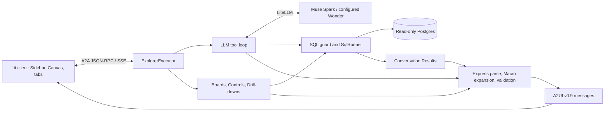

# Explorer

Explorer answers plain-English questions about a Postgres Dataset with prose and generated
charts, tables, and metrics. It also supports an Explorer Board as a landing page, Entity
Boards opened from rows, Controls that re-query a Board in place, and Drill-downs into results.
The client keeps an investigation log and tabs for the views opened during a Conversation.

The central rule is that
the model refers to stored Results instead of retyping data into the UI. Server-side Macros
produce Visuals and expose their SQL. `Cite` placeholders insert database values into prose.
Bare numbers in model-written prose are warned about rather than universally rejected, since
years and phrases such as “top 10” are also numbers.

## Reading order and status

Start with this README and the [glossary](../CONTEXT.md), then use [SPEC.md](SPEC.md) for the
behavioral contract. Later dated amendments supersede earlier sections. In particular, §18
updates the original chat architecture with Boards, Controls, Entity Boards, and investigation
tabs. [BUILD_PROMPT.md](BUILD_PROMPT.md) is the original brief; the spec takes precedence.

Questions, Boards, Controls, Drill-downs, Workspaces, saved Conversations, and the New Workspace
wizard are implemented. Runtime drafting of missing Entity Boards remains a later slice.
The Spark/Glimmer serving split was stopped; the configured answer model writes the Surface.

## Architecture and request paths



### A typed question

1. The browser sends the question with its A2A context and supported catalog ID. The server
   creates or resumes a Conversation, loading saved state in Workspace mode when needed.
2. The model receives the A2UI rules/catalog, generic instructions, and Dataset context in a
   stable cached prefix, followed by conversation history. The Data dictionary comes from
   database comments with an optional Comment overlay.
3. The model calls `list_tables`, `describe_table`, or `run_sql`. The schema is already in the
   prompt, so a typical answer needs a SQL call and an answer call. Independent tool queries
   can run concurrently.
4. `SqlRunner` guards and executes the SQL. Results receive IDs such as `r1`, and only a
   bounded preview is sent back to the model.
5. The model returns prose plus `<a2ui>…</a2ui>` Express. `UiPipeline` parses it, expands Macros
   against the Results, rewrites Surface IDs, and validates the catalog and properties. A
   bounded Repair loop can correct invalid UI using the existing Results.
6. A2A carries prose and A2UI messages to Lit. Progress events stream while the work runs;
   Express itself is compiled as a complete reply rather than incrementally rendered.

### Boards and interactions

A Board is Dataset configuration: named parameterised SQL queries, optional Controls, and an
Express layout of Macro calls. Startup checks its queries and referenced columns. Rendering
runs the queries and expands the layout without calling the model; query concurrency, row
caps, and an in-memory cache bound the work.

- The Explorer Board has no entity key and opens as the first tab when configured.
- An Entity Board is keyed on a column in a clicked row and shows that entity across the
  Dataset. Its scope is distinct from the filters of the answer that led to it.
- A Control change binds validated parameters and updates dependent panels in the same tab.
- A Drill-down runs a query supplied ahead of time for that Visual, bound to the clicked row.
- An Ask consults the model after confirmation; Follow-up buttons also take this path.

## One mode: Workspaces with Settings

The explorer has one mode: the agent serves the Workspaces listed in
`$EXPLORER_DATA_DIR/workspaces.toml`, the bootstrap server backs Settings, and the client always
shows the Workspace picker and Settings. `EXPLORER_DATA_DIR` is required, an absolute path outside
the repo. Each Workspace names its Dataset directory and the variable holding its read-only login.
Conversations are saved per Workspace in SQLite; Results retain SQL, with rows fetched again when
needed. Settings adds and regenerates Workspaces through New Workspace:
Database → Draft → Review → Boards → Export. See the [setup guide](bootstrap/README.md).
The application is local and has no authentication.

## Code map

| Path | Responsibility |
|---|---|
| `agent/src/explorer_agent/` | A2A server, model tool loop, SQL safety, Macros, Boards, Workspace routing and saved Conversations |
| `client/src/` | Lit shell, tabs, Actions, Controls and Settings |
| `catalog/` | Shared custom-component schemas |
| `../datasets/<name>/` | Owner’s deployment Dataset files and Boards |
| `bootstrap/` | Dataset reporting, drafting, review and export |
| `specs/` | Detailed behavioral contracts |
| `spike/` | Historical feasibility evidence |

The agent module map is in [SPEC §8](SPEC.md); contributor rules are in [AGENTS.md](AGENTS.md).

## Prerequisites

Use Python 3.13, `uv`, Node.js 20 or later, and npm. Docker with Compose is needed for local
Dataset databases and database tests. The launcher uses Bash and `curl`. Initial dependency
installation needs network access; the A2UI Python packages come from a pinned Git commit.

Commands below start from the repository root unless a working directory is stated.

## Run

1. Prepare a database using [VicProp's setup](../vicprop/README.md#setup-and-load) or
   [AusTender's setup](../austender/README.md#setup), or bring your own with a read-only login.
   Wait until the database is healthy and loaded.
2. If there is no root `.env`, copy the example from the repository root, then fill it in:

   ```bash
   cp explorer/.env.example .env
   ```

   ```dotenv
   META_API_KEY=<your-meta-api-key>
   MODEL=meta/muse-spark-1.3
   EXPLORER_DATA_DIR=~/.glassline/workspaces
   VICPROP_DATABASE_URL=postgresql://explorer_ro:<password>@localhost:5435/vicprop
   ```

   The password is that database project's `EXPLORER_RO_PASSWORD`, not its loader password.
   URL-encode special characters in passwords used in a DSN.
3. Install and start everything:

   ```bash
   cd explorer/agent && uv sync --locked
   cd ../client && npm ci
   cd .. && ./run.sh
   ```

Open **http://127.0.0.1:5173**. With no Workspaces yet, the app offers New Workspace: pick the
`*_DATABASE_URL` login, let the model draft the Dataset and Boards, review, and export. To serve
a committed Dataset such as `../datasets/vicprop` instead, list it in
`$EXPLORER_DATA_DIR/workspaces.toml`, naming a Connection from `$EXPLORER_DATA_DIR/connections.toml`:

```toml
# workspaces.toml
[[workspace]]
name = "vicprop"
dataset_dir = "datasets/vicprop"   # relative to the repo root, or absolute
connection = "vicprop"

# connections.toml (the login stays in .env)
[[connection]]
name = "vicprop"
label = "Victorian house prices"
url_env = "VICPROP_DATABASE_URL"
```

To add a database of your own, see
[Add an existing Postgres database](bootstrap/README.md#add-an-existing-postgres-database).

`run.sh` starts the agent, the bootstrap server (Settings) and the client, and stops all three on
Ctrl-C. A Workspace whose login can write, or whose Dataset or Boards are invalid, is listed as
unavailable with its reason.

## Configuration

The agent loads the root `.env`, or the file named by `EXPLORER_ENV_FILE`, without overriding
existing environment variables. A Workspace's relative `dataset_dir` resolves against the repo
root; absolute paths and `~` are supported. Manually edited Dataset files need a restart or
Workspace reload; Settings export reloads the agent automatically.

| Settings | Role |
|---|---|
| `MODEL`, `META_API_KEY`, `REASONING_EFFORT` | Serving model, credentials, and reasoning setting; Spark is the default, Wonder is permitted |
| `FORMAT` | Output format; Boards require `express` |
| `SQL_TIMEOUT_MS`, `SQL_ROW_CAP`, `ROWS_TO_MODEL`, `TABLE_ROW_CAP` | Query duration, stored rows, model preview, displayed table rows |
| `MAX_TOOL_ITERATIONS`, `MAX_UI_RETRIES`, `TURN_TIMEOUT_S` | Model/Repair and Turn limits |
| `PROMPT_CACHE_KEY`, `HISTORY_MODE` | Cache namespace and compact/full history |
| `DRILL_*`, `MAX_DRILLS_PER_SURFACE` | Drill checking and prefetch limits |
| `BOARD_*`, `MAX_BOARD_CACHE`, `MAX_BOARD_INSTANCES`, `MAX_CONTROL_OPTIONS` | Board concurrency, rows, caching, instances, and Control limits |
| `AGENT_HOST`, `AGENT_PORT`, `CLIENT_ORIGIN`, `LOG_LEVEL` | Server binding, CORS, and logging |
| `EXPLORER_DATA_DIR` | Required. The Workspaces and saved Conversations; must be outside the repo |
| `<NAME>_DATABASE_URL` | A read-only login; a Connection names it as its `url_env`, and Settings offers each one |
| `VITE_AGENT_URL`, `VITE_BOOTSTRAP_URL` | Browser agent URL and Settings API URL; set together by `run.sh` |

See [.env.example](.env.example) and [`config.py`](agent/src/explorer_agent/config.py) for
individual defaults and validation. `run.sh` fixes the client origin/port at 5173 and passes
matching agent binding settings; choose its agent port with an exported `AGENT_PORT`.

## Add or maintain a Dataset

Keep Dataset-specific names and behavior in `../datasets/<name>/` or a Workspace under
`EXPLORER_DATA_DIR`. The bootstrap CLI exports to `~/.glassline` by default; use
`--root` to export elsewhere. `dataset.toml` selects
allowed schemas, context files, currency formatting, and starter questions. Notes explain
querying rules; the glossary explains domain language. Database `COMMENT ON` text supplies
the Data dictionary, with `comments.toml` optionally replacing selected descriptions.
`scenarios.toml` is evaluation material, separate from starter examples.

Optional `boards/*.toml` files define the Explorer Board and Entity Boards. Use the
[bootstrap tool](bootstrap/README.md) to report on a database, draft Dataset files, review
claims/comments, and draft/check Boards before exporting. A database administrator must
create the read-only role and grants; bootstrap does not write to the database.

## Build and test

Run each block from its stated directory:

```bash
# explorer/agent/
uv run pytest
uv run pytest -m 'not db and not live_db'

# explorer/client/
npm test
npm run build
```

The default agent suite excludes `live_db` and includes Docker-backed tests. The client
interop test starts the test-only stub agent (one fake Workspace), so `uv` must be on PATH. Database tests use a disposable
Postgres 18 built from `austender.testing.build_test_db`; production code has no dependency
on AusTender tables. No ordinary test calls a real model or external API.

The following checks deliberately read your configured real database, without a model call:

```bash
# explorer/agent/
LIVE_WORKSPACE=<name> uv run pytest -m live_db
uv run python -m explorer_agent boards <name>
```

Both name a Workspace in `EXPLORER_DATA_DIR`. The `boards` command validates Boards and times cold rendering of unkeyed Boards. Entity
Boards are checked but not timed because they require a clicked entity key.

After an intentional prompt change, regenerate prompt snapshots with
`UPDATE_SNAPSHOTS=1 uv run pytest tests/test_prompt.py`. To update the client transport fixture,
run `UPDATE_FIXTURES=1 uv run pytest tests/test_ui.py`. Review the resulting diff.

Live scenario and reasoning-effort experiments are separate from tests and invoke the model.
See [`specs/scenarios/SPEC.md`](specs/scenarios/SPEC.md) and
[`specs/effort-check/SPEC.md`](specs/effort-check/SPEC.md) before using the scripts in
`agent/scripts/`.

## Maintenance

Read [AGENTS.md](AGENTS.md) before changes. It covers SQL safety, prompt caching, catalog
compatibility, dependency pins, secrets and vendored code. Logs record token counts, timings,
SQL and row counts; see [agent logging](agent/README.md#logs).

## Troubleshooting

| Symptom | Check |
|---|---|
| Launcher reports another agent | Stop the existing process on port 10002, or export another `AGENT_PORT` before launching |
| Database connection fails | Compose health, host port, database name, read-only password, and matching Dataset |
| Login rejected at startup | Use `explorer_ro`; do not use the loader or a superuser |
| Board fails startup | Query output names/types, allowed schemas, Control definitions, and Macro column references |
| Browser cannot call the agent | `VITE_AGENT_URL` and `CLIENT_ORIGIN`; `localhost` and `127.0.0.1` are different origins |
| Component silently missing | Shared catalog ID, custom-component schema, and Lit registration |
| Database tests fail immediately | Docker daemon and permission to start Testcontainers |
| Settings edit has no effect | Existing exported environment overrides `.env`; restart the agent after configuration changes |
