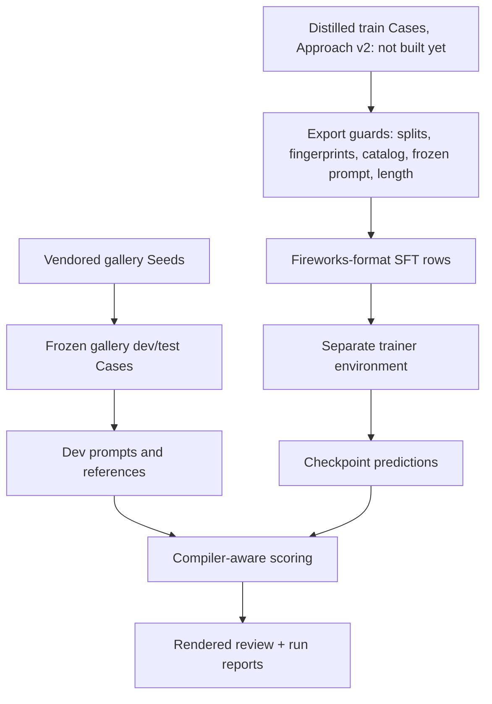

# glimmer-tune

glimmer-tune builds training/evaluation data and measures Muse Glimmer 30B's ability to write
**A2UI Express**. It includes a compiler-aware scorer, frozen gallery eval sets, human
review pages, checkpoint comparisons, constrained-decoding grammar generation, and a separate
Fireworks supervised fine-tuning (SFT) trainer.

The implemented training target is the **generic A2UI v0.9 basic catalog**, rather than
Explorer's Result-backed Macros. This project does not ingest a database or write SQL for
Explorer. Muse Glimmer is used only to generate A2UI.

**Approach v2:** distill candidates from a teacher and filter them. Teacher measurements,
intent generation, an Explorer dev slice, layered validation/rendering and judge-calibration
tools are implemented. The distilled training set is still to be built. Runs 1 and 2’s
template/synthetic generators are retired in `archive/`; see the [restart brief](docs/distill_restart_prompt.md).

Use [CONTEXT.md](CONTEXT.md) for vocabulary, [SPEC.md](SPEC.md) for the latest phase/status,
and [AGENTS.md](AGENTS.md) for change rules. The proposed Explorer serving split was stopped;
Explorer continues to generate Surfaces with its answer model.

## Architecture



Gallery Families belong to a single train/dev/test split. The dev (84) and test (136) Cases
were generated from Family Templates that are now archived. The frozen case files are the
source of truth. There is no synthetic dev set; the 200 rows of the run 2 one were deleted on 2026-11-05.

Exports reject split/fingerprint leakage, invalid catalog use, a changed frozen system
prompt, and excessive sequence length. SFT rows train the answer only; reasoning strength
is explicitly `low`. The trainer writes checkpoint predictions and invokes the scorer in
the harness environment instead of importing its dependencies.

## Project map

| Path | Responsibility |
|---|---|
| `a2ui_eval/sdk.py`, `convert.py`, `refs.py` | Pinned A2UI SDK adapter, v1-to-v0.9 conversion, catalog/component references |
| `a2ui_eval/seeds.py`, `fingerprint.py`, `io.py` | Seeds, structural fingerprints, JSONL/split helpers |
| `a2ui_eval/catalog_model.py`, `lint.py`, `structhash.py` | Catalog model, S8 plausibility lint, near-duplicate hash |
| `a2ui_eval/export.py`, `prompt.py`, `data_cli.py` | SFT export guards, frozen prompt, data commands |
| `a2ui_eval/score.py`, `structure.py`, `surfaces.py`, `align.py`, `catalog_check.py` | Compilation, stateful Surface checks, bindings, component alignment, catalog checks |
| `a2ui_eval/checkpoints.py` | Dev/test prompt exports, checkpoint scoring, paired test comparison |
| `a2ui_eval/grammar.py` | Catalog-derived Express grammar with Glimmer channel framing |
| `a2ui_eval/review.py`, `review/` | Python review server and Vite + Lit UI |
| `a2ui_eval/teacher.py`, `llm_call.py`, `phase1.py` | Teacher sampling and measurement |
| `a2ui_eval/intents/` | Intent generation, checks and held-out Explorer slice |
| `a2ui_eval/validate.py`, `render.py` | Layered candidate validation and browser rendering |
| `a2ui_eval/judge.py`, `data/judge/` | Human labelling, judge calibration and agreement reports |
| `catalogs/`, `seeds/gallery/` | Vendored catalogs and 43 verbatim upstream gallery Seeds |
| `data/splits.yaml` | Family split assignments (and the run 2 Skeleton splits, history) |
| `data/system_prompt.txt` | Frozen prompt used by training and inference |
| `data/dev/`, `data/test/` | Frozen gallery Cases; the test split is held for final evaluation |
| `data/fewshot3.jsonl` | The 3 frozen few-shot examples for base-model evaluation |
| `data/intents_draft.jsonl` | History: how the dev/test intents were reviewed |
| `archive/` | Retired template and synthetic generators, their data and tests; not imported |
| `trainer/` | Independent Python project for prepare/train/sample |
| `exports/`, `runs/` | Ignored generated exports, checkpoints' metadata, predictions, scores, and logs |
| `docs/` | Run plans, reviews, reports, and decisions based on measurements |

## Install and run local checks

Use Python 3.13 and `uv`. Node.js 20+/npm is needed only for the review UI. Docker is not
needed for the harness. Dependency installation needs network access for the pinned A2UI
SDK and, in the trainer, Fireworks packages. Some data/prepare commands load a tokenizer
from Hugging Face on first use; they are not necessarily offline just because they avoid a
model call.

From the repository root:

```bash
cd glimmer-tune
uv sync --locked
uv run pytest -n auto --dist loadgroup -m 'not slow'
```

The fast tier is for iteration. Run the full suite before declaring a data/scorer change done:

```bash
# glimmer-tune/
uv run pytest -n auto --dist loadgroup

# Separate trainer environment
cd trainer
uv sync --locked
uv run pytest
```

Tests stub model/network calls. One optional provenance test compares the vendored catalog
with `../a2ui/` and skips if the reference clone is absent; runtime uses the vendored files.

## Inspect and export existing data

Run from `glimmer-tune/`. These commands make no live model calls:

```bash
uv run python -m a2ui_eval.data_cli --help
uv run python -m a2ui_eval.data_cli lint --gallery
uv run python -m a2ui_eval.data_cli lint --synthetic PATH/cases.jsonl
uv run python -m a2ui_eval.data_cli export-dev
uv run python -m a2ui_eval.data_cli grammar
```

`export-dev` writes `exports/sft_dev.jsonl`; `grammar` writes `exports/express_chat.gbnf`.

`export --train PATH` turns train Cases into SFT rows (`exports/sft_train.jsonl` by default),
using real tokenizer counts; `--approx-tokens` is an offline estimate. There is no train set
until Approach v2 builds the distilled one. `freeze-prompt` freezes the prompt and refuses an
incompatible existing file unless forced.

Do not regenerate the frozen test split or use it for iteration. Test prompt export and
sampling are reserved for the decided final evaluation. Export guards may inspect held-out
metadata/references to prevent leakage; that is distinct from using test predictions to
choose a model.

Do not edit vendored gallery Seeds. Keep catalogs and SDK packages on shared commit
`825beac2813a6d0ccef3b6fb4124ad6c3c8419f0`, also used by Explorer. Changing that pin means
reviewing conversion, rebuilt references, prompt compatibility, and scores. Preserve the
[catalog](catalogs/README.md) and [Seed](seeds/README.md) provenance/license notices.

## Human review

Build the browser UI once, from `glimmer-tune/`:

```bash
cd review
npm ci
npm run build
cd ..
uv run python -m a2ui_eval.review --port 8767
```

Open **http://127.0.0.1:8767**. The explicit port avoids the bootstrap server’s default 8765;
the review server also defaults to 8765 if `--port` is omitted.
Default mode edits intent text and review flags in `data/intents_draft.jsonl`.

To review rows from any cases file, use
`uv run python -m a2ui_eval.review --synthetic PATH/cases.jsonl --sample 50 --port 8767`.
For checkpoint gallery review, pass `--predictions PATH --scores PATH`; verdicts are written
alongside scores unless overridden. Build `review/dist` again after UI changes.

## Trainer and checkpoint scoring

The [trainer](trainer/README.md) uses a separate environment for the Fireworks SDK. Its guide
covers prepare/train/sample, environment loading and paid-command requirements. Export train
Cases and dev prompts first, and pass the train export with `--train`: the historical default
`sft_mix.jsonl` is retired.

Score existing predictions from `glimmer-tune/`, without another model call:

```bash
uv run python -m a2ui_eval.checkpoints score runs/example/predictions.jsonl --out runs/example/scores.json
```

Replace the example paths with an existing run's files before running. The default scores a fixed dev subset;
use `--full` for predictions covering all dev rows and `--dev PATH` for a different dev prompt
export. Scoring checks extraction/truncation, compilation, SDK/schema validity, tree structure,
bindings, catalog use, exact matching, and slot scores. Name-blind slot F1 avoids penalising
equivalent component/path names. A score is a reference comparison, not a substitute for
rendered review; results also report failure modes and uncertainty.

## Model and experiment boundaries

- Muse Glimmer 30B, base or tuned adapters, generates A2UI only.
- Hosted Model API models (`muse-spark-1.x`, `muse-wonder-*`) stay out of training data;
  evaluation only.
- Spark Open may teach, write intents and judge. An adapter trained on any of its
  output is a Muse Model License Derivative: a product using it must show "Built with Muse
  Spark Open".
- Reasoning strength is `low` in training rows and normal inference. Exceptions are the
  dev-only high-reasoning base-model experiment and Phase 1 teacher measurements at low/medium;
  training rows remain low.
- The prompt is frozen. Forcing a new prompt invalidates compatibility with existing adapters
  and requires a deliberate new run rather than an onboarding “fix”.
- Keep Family splits and fingerprint guards intact. Select checkpoints on dev, then
  conduct the final test evaluation only when decided.

If exports fail, inspect the reported prompt, catalog, leakage, or length violation rather
than weakening the guard. If an old run path is absent, remember `runs/` and `exports/` are
ignored; committed reports preserve evidence, but a fresh checkout will not contain every
prediction or checkpoint manifest.
