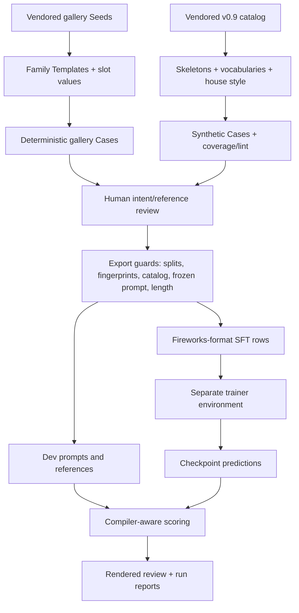

# glimmer-tune

glimmer-tune builds training/evaluation data and measures Muse Glimmer 30B's ability to write
**A2UI Express**. It includes a compiler-aware scorer, deterministic data generation, human
review pages, checkpoint comparisons, constrained-decoding grammar generation, and a separate
Fireworks supervised fine-tuning (SFT) trainer.

The implemented training target is the **generic A2UI v0.9 basic catalog**, rather than
Explorer's Result-backed Macros. This project does not ingest a database or write SQL for
Explorer. Muse Glimmer is used only to generate A2UI.

Read [CONTEXT.md](CONTEXT.md) for Seed, Family, Template, Skeleton, Case, and Fingerprint;
[AGENTS.md](AGENTS.md) for change rules; and [SPEC.md](SPEC.md) for the behavioral contract.
The spec is a chronological record: later amendments supersede its opening milestone-2a
draft. Its proposed run 3, Brief → Macro Surface track is not approved or implemented as the
Explorer serving path. Current run-2 evidence and open decisions are in the
[decision memo](docs/run2-decision-memo-20261104.md), not a promise of production deployment.

## Architecture



Gallery Families belong to a single train/dev/test split. Handwritten Templates vary a
Family's slots deterministically. Synthetic Skeletons supply additional layouts and are
also split as units; a catalog-driven generator fills them with reviewed vocabularies,
data bindings, validation checks, and actions. These are generated UI examples, not live
database Results.

Exports reject split/fingerprint leakage, invalid catalog use, a changed frozen system
prompt, and excessive sequence length. SFT rows train the answer only; reasoning strength
is explicitly `low`. The trainer writes checkpoint predictions and invokes the scorer in
the harness environment instead of importing its dependencies.

## Project map

| Path | Responsibility |
|---|---|
| `a2ui_eval/sdk.py`, `convert.py`, `refs.py` | Pinned A2UI SDK adapter, v1-to-v0.9 conversion, catalog/component references |
| `a2ui_eval/seeds.py`, `generate.py`, `fingerprint.py` | Seeds, Family Templates, deterministic gallery Cases, structural fingerprints |
| `a2ui_eval/synth/` | Catalog model, Skeletons, vocabularies, bindings, intents, coverage, house style, plausibility lint |
| `a2ui_eval/export.py`, `prompt.py`, `data_cli.py` | SFT export guards, frozen prompt, data commands |
| `a2ui_eval/score.py`, `structure.py`, `surfaces.py`, `align.py`, `catalog_check.py` | Compilation, stateful Surface checks, bindings, component alignment, catalog checks |
| `a2ui_eval/checkpoints.py` | Dev/test prompt exports, checkpoint scoring, paired test comparison |
| `a2ui_eval/grammar.py` | Catalog-derived Express grammar with Glimmer channel framing |
| `a2ui_eval/review.py`, `review/` | Python review server and Vite + Lit UI |
| `a2ui_eval/teacher.py` | Scoped Spark Open baseline for data work (ADR 0025); never an SFT target |
| `catalogs/`, `seeds/gallery/` | Vendored catalogs and 43 verbatim upstream gallery Seeds |
| `families/` | Handwritten YAML Templates |
| `data/splits.yaml` | Family and Skeleton split assignments |
| `data/system_prompt.txt` | Frozen prompt used by training and inference |
| `data/train/`, `data/dev/`, `data/test/` | Gallery Cases; the test split is held for final evaluation |
| `data/synth/` | Synthetic Cases, coverage reports, review verdicts |
| `trainer/` | Independent Python project for prepare/train/sample |
| `exports/`, `runs/` | Ignored generated exports, checkpoints' metadata, predictions, scores, and logs |
| `docs/` | Run plans, reviews, reports, and decisions based on measurements |

## Install and run local checks

Use Python 3.13 and `uv`. Node.js 20+/npm is needed only for the review UI. Docker is not
needed for the harness. Dependency installation needs network access for the pinned A2UI
SDK and, in the trainer, Fireworks packages. Some data/prepare commands load a tokenizer
from Hugging Face on first use; they are not necessarily offline just because they avoid a
model call.

From the repository root:

```bash
cd glimmer-tune
uv sync --locked
uv run pytest -n auto --dist loadgroup -m 'not slow'
```

The fast tier is for iteration. Run the full suite before declaring a data/scorer change done:

```bash
# glimmer-tune/
uv run pytest -n auto --dist loadgroup

# Separate trainer environment
cd trainer
uv sync --locked
uv run pytest
```

Tests stub model/network calls. One optional provenance test compares the vendored catalog
with `../a2ui/` and skips if the reference clone is absent; runtime uses the vendored files.

## Inspect and export existing data

Run from `glimmer-tune/`. These commands make no live model calls:

```bash
uv run python -m a2ui_eval.data_cli --help
uv run python -m a2ui_eval.data_cli vocab --all --check
uv run python -m a2ui_eval.data_cli lint --gallery
uv run python -m a2ui_eval.data_cli lint --synthetic data/synth/train/cases.jsonl
uv run python -m a2ui_eval.data_cli coverage
uv run python -m a2ui_eval.data_cli export-dev
uv run python -m a2ui_eval.data_cli grammar
```

`coverage` rewrites the generated coverage JSON/README under `data/synth/`. `export-dev`
writes `exports/sft_dev.jsonl`; `grammar` writes `exports/express_chat.gbnf`.

Build the trainer's default mixed training export from the committed Cases:

```bash
uv run python -m a2ui_eval.data_cli export --mix 0.7 --out exports/sft_mix.jsonl
```

This combines synthetic and gallery training rows, using real tokenizer counts. For an
offline inspection of the export path, `--approx-tokens` uses an estimate instead; it is not
a substitute for the trainer's actual token-length checks. `--mix` controls the synthetic
share. Without it, the exporter writes gallery-only rows to `exports/sft_train.jsonl` by
default. Neither export launches training.

## Change or regenerate data deliberately

The following are authoring operations, not installation steps: they write committed Cases
or review artifacts. Inspect diffs and preserve reviewed intent text.

| Command prefix: `uv run python -m a2ui_eval.data_cli` | Purpose |
|---|---|
| `generate --count N --seed 0` | Regenerate training Cases per gallery Family |
| `draft --keep-reviews` | Regenerate candidate eval intents while preserving compatible human reviews |
| `build-eval --split dev` | Build dev Cases from rows marked `reviewed: true` |
| `synth --split train --count N --seed 0` | Generate training synthetic Cases without model calls |
| `synth --split dev --count N --seed 0` | Generate synthetic dev Cases without model calls |
| `vocab --all` | Call Muse Spark to draft vocabularies; review before use |
| `freeze-prompt` | Freeze the prompt; refuses an incompatible existing file unless explicitly forced |

Do not regenerate the frozen test split or use it for iteration. Test prompt export and
sampling are reserved for the decided final evaluation. Export guards may inspect held-out
metadata/references to prevent leakage; that is distinct from using test predictions to
choose a model.

Do not edit vendored gallery Seeds. Keep catalogs and SDK packages on shared commit
`825beac2813a6d0ccef3b6fb4124ad6c3c8419f0`, also used by Explorer. Changing that pin means
reviewing conversion, rebuilt references, prompt compatibility, and scores. Preserve the
[catalog](catalogs/README.md) and [Seed](seeds/README.md) provenance/license notices.

## Human review

Build the browser UI once, from `glimmer-tune/`:

```bash
cd review
npm ci
npm run build
cd ..
uv run python -m a2ui_eval.review --port 8767
```

Open **http://127.0.0.1:8767**. The chosen port avoids the bootstrap server's default 8765
and wrapper's 8766. The review server's own default is 8765 if `--port` is omitted.
Default mode edits intent text and review flags in `data/intents_draft.jsonl`.

For synthetic review, use
`uv run python -m a2ui_eval.review --synthetic data/synth/train/cases.jsonl --sample 50 --port 8767`.
For checkpoint gallery review, pass `--predictions PATH --scores PATH`; verdicts are written
alongside scores unless overridden. Build `review/dist` again after UI changes.

## Trainer and checkpoint scoring

The trainer is separate because its Fireworks training SDK/cookbook environment differs from
the compiler/scorer environment (ADR 0015). Do not install trainer dependencies into the
Explorer agent or the main harness environment.

After exporting training rows and dev prompts, run from `glimmer-tune/trainer/`:

```bash
uv run python -m glimmer_trainer --help
uv run python -m glimmer_trainer prepare
uv run python -m glimmer_trainer train
```

`prepare` checks rendered data/token lengths and reports it without opening a remote training
session. `train` without `--launch` also validates and reports, then exits without launching.
Both expect `../exports/sft_mix.jsonl`, `../exports/sft_dev.jsonl`, and the frozen prompt by
default; flags can select other files. Tokenizer loading can require network access.

Live `train --launch --run-id NAME` and `sample` require explicit authorization under this
project's instructions. Sampling is billed; confirm the current service terms and cost
before remote work. Commands do not automatically load the root `.env`; supply the relevant
environment or use `uv run --env-file ../../.env …` from `trainer/`. Credentials must never
appear in source, logs, or committed manifests.

`sample` requires `--run`, `--ckpt`, `--cases`, and `--out`, supports an optional grammar and
budget, and refuses to overwrite predictions. Use one worker when measuring latency so
concurrent requests do not distort shared-pool queueing. Run directories contain manifests,
checkpoint identities, predictions, and score artifacts; they are ignored by Git.

Score existing predictions from `glimmer-tune/`, without another model call:

```bash
uv run python -m a2ui_eval.checkpoints score runs/example/predictions.jsonl --out runs/example/scores.json
```

Replace the example paths with an existing run's files before running. The default scores a fixed dev subset;
use `--full` for predictions covering all dev rows and `--dev PATH` for a different dev prompt
export. Scoring checks extraction/truncation, compilation, SDK/schema validity, tree structure,
bindings, catalog use, exact matching, and slot scores. Name-blind slot F1 avoids penalising
equivalent component/path names. A score is a reference comparison, not a substitute for
rendered review; results also report failure modes and uncertainty.

## Model and experiment boundaries

- Muse Glimmer 30B, base or tuned adapters, generates A2UI only.
- Muse Spark may draft vocabulary as specified. Spark Open via Baseten is restricted to the
  scoped teacher baseline/data work; its Express is never an SFT target.
- Reasoning strength is `low` in training rows and normal inference. The spec names one
  dev-only high-reasoning base-model experiment; do not silently mix its results.
- The prompt is frozen. Forcing a new prompt invalidates compatibility with existing adapters
  and requires a deliberate new run rather than an onboarding “fix”.
- Keep Family/Skeleton splits and fingerprint guards intact. Select checkpoints on dev, then
  conduct the final test evaluation only when decided.

If exports fail, inspect the reported prompt, catalog, leakage, or length violation rather
than weakening the guard. If an old run path is absent, remember `runs/` and `exports/` are
ignored; committed reports preserve evidence, but a fresh checkout will not contain every
prediction or checkpoint manifest.
