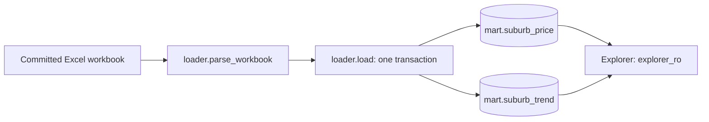

# vicprop

Victorian suburb median house prices in Postgres 18, built for the explorer's LLM agent.
The source is the committed `houses-by-suburb-2015-2025.xlsx` workbook, containing annual
medians for 2015–2025, preliminary 2026 medians, flags, and published growth figures.
This is a small second Dataset for the dataset-agnostic Explorer and its bootstrap tool.

See [SPEC.md](SPEC.md) for the behavioral contract (its header remains marked draft),
[AGENTS.md](AGENTS.md) for change rules, and the
[Explorer README](../explorer/README.md) for the application that consumes it.

## Architecture



There is no live ingest client, raw schema, scheduler, or model call. The workbook is the
source of truth. Parsing is separate from database loading so it can be tested with in-memory
workbooks. Loading replaces the mart tables using `DELETE` and inserts in one transaction;
readers continue to see the previous committed data until the new load commits.

## Prerequisites

Python 3.13, `uv`, and Docker with Compose v2. Keep Docker running for setup and database
tests. First-time dependency/image installation needs network access; workbook loading does
not. This package uses `openpyxl`, `psycopg` 3, and plain SQL migrations, with no Node project.

## Setup and load

```bash
cd vicprop
cp .env.example .env   # then set passwords
docker compose up -d --wait # Postgres 18 on host port 5435
uv sync
uv run vicprop migrate # create roles, schemas, mart tables
uv run vicprop load    # load houses-by-suburb-2015-2025.xlsx into mart
uv run vicprop stats   # row counts, year range
```

Start this block from the repository root. Later commands assume `vicprop/`. Copy the example
only if `vicprop/.env` does not exist; otherwise edit it. This settings file is separate from
the root Explorer `.env`.

A successful load prints the price-row and locality counts. The committed source has 797
localities; the year range reaches 2026 because preliminary medians are included. `stats`
reports preliminary/flagged rows and trend localities as well as the price rows. Loading the
same workbook again produces the same tables. `docker compose stop` retains the data volume.

## Configuration and commands

The CLI loads `vicprop/.env` without overriding existing environment variables.

| Variable | Default / purpose |
|---|---|
| `POSTGRES_HOST`, `POSTGRES_PORT`, `POSTGRES_DB` | `localhost`, `5435`, `vicprop` |
| `LOADER_PASSWORD` | `vicprop_loader` password; also initialises the Compose database |
| `EXPLORER_RO_PASSWORD` | Read-only login password created/updated by `migrate` |
| `VICPROP_XLSX` | `houses-by-suburb-2015-2025.xlsx`; relative paths resolve from `vicprop/` |

| Command, from `vicprop/` | Behavior |
|---|---|
| `uv run vicprop migrate` | Ensure roles and apply pending checksum-verified SQL migrations |
| `uv run vicprop load` | Parse the configured workbook and transactionally refill both mart tables |
| `uv run vicprop load --xlsx /absolute/path/source.xlsx` | Load a workbook with the same expected structure from an explicit path |
| `uv run vicprop stats` | Print counts, year range, and preliminary/flagged rows |
| `uv run pytest` | Run parser tests and Docker-backed database tests |

Compose initialises credentials only for a new volume. Editing `LOADER_PASSWORD` in `.env`
does not change an existing database password; coordinate role and settings changes.

## Tables and interpretation

| Table | Grain | Key fields |
|---|---|---|
| `mart.suburb_price` | One published median per locality and calendar year | `locality`, `year`, `median_price`, `is_prelim`, `flagged` |
| `mart.suburb_trend` | One published summary per locality | `locality`, `change_24_25_pct`, `growth_15_25_pct`, `growth_pa_pct` |

- Prices are Australian dollars as published. A suburb median is not a transaction-level
  observation: averaging suburb medians does not produce a statewide median.
- A dash in an annual source cell means **no row**, never a zero or NULL median.
- Preliminary 2026 `NA` values also produce no price row. Published summary `NA` values become
  NULL fields in `suburb_trend`.
- `is_prelim` identifies 2026. Prefer completed years for comparisons and label preliminary
  figures when using them.
- `flagged` records `^` or `*`. The workbook has no flag legend; describe flagged values as
  needing caution, without inventing a cause.
- Growth figures in `suburb_trend` are preserved as published. Recompute from the long price
  table when answering a question about a different period.

## How the explorer connects

The explorer uses the read-only role `explorer_ro` (`SELECT` on schema `mart` only),
configured in `../explorer/datasets/vicprop/dataset.toml`. The agent's only data
dictionary is the `COMMENT ON` text on the `mart` tables and columns (see
`migrations/0002_mart.sql`).

Set these values in the repository root `.env`, replacing the password placeholder with
`vicprop/.env`'s `EXPLORER_RO_PASSWORD` (URL-encoded where necessary):

```dotenv
DATABASE_URL=postgresql://explorer_ro:<password>@localhost:5435/vicprop
DATASET_DIR=datasets/vicprop
```

Configure `META_API_KEY` and the serving model as described in
[Explorer's setup](../explorer/README.md#run-against-a-real-dataset). The loader login owns the
schemas and performs writes; Explorer must use the separate `explorer_ro` login. Dataset
notes, glossary, examples, optional overlays, and Boards live under
[`../explorer/datasets/vicprop/`](../explorer/datasets/vicprop/).

## Layout

- `houses-by-suburb-2015-2025.xlsx` — the committed source workbook (manual download;
  `land.vic.gov.au` blocks scripts with HTTP 403). Source: Victorian Government (land.vic.gov.au), licensed CC BY 3.0 AU (https://creativecommons.org/licenses/by/3.0/au/); credit is also in the root `NOTICE`.
- `migrations/` — plain SQL, applied in order by our own runner (`src/vicprop/db.py`).
- `src/vicprop/loader.py` — workbook parse plus `load` (refill `mart` in one transaction).
- `src/vicprop/testing.py` — `build_test_db(dsn)` for the explorer's tests.

Also see `src/vicprop/config.py` for environment/path handling, `cli.py` for commands, `db.py`
for roles/migrations, and `docker-compose.yml` for the database and named volume. `ops` stores
applied migrations. There is no `raw` or `core` schema in this project.

## Tests and schema changes

From `vicprop/`:

```bash
uv sync --locked
uv run pytest
uv run pytest tests/test_loader.py
```

Parser tests create workbooks in memory and need no database. Database tests start disposable
Postgres 18 containers and verify the committed workbook, missing/preliminary values, comments,
and idempotent loading. Tests make no external API or model calls. `build_test_db(dsn)` is an
available integration helper: it creates roles, migrates, and loads the committed workbook
into an empty database supplied by the caller. Explorer's current default test dependency
is AusTender; the VicProp helper is not automatically selected by changing `DATASET_DIR`.

Never edit an applied migration; add a new numbered file. Every mart table/column needs a
`COMMENT ON` explaining its meaning to the agent. Tests enforce a 12,000-character total
comment budget. Keep workbook parsing deterministic and preserve the missing-value rules.

## Troubleshooting

| Symptom | Check |
|---|---|
| Connection/authentication failure | Compose health, port 5435, and credentials matching the existing database roles |
| Workbook not found | `VICPROP_XLSX` resolves relative to this project; check the override or use an absolute path |
| Fewer observations for a locality | Missing medians are absent rows, not zeros; preliminary 2026 also has missing values |
| Explorer shows the wrong Dataset | Update both root `DATABASE_URL` and `DATASET_DIR`, then restart the agent |
| Migration checksum mismatch | Restore the applied file and express changes in a new migration |
| Database tests fail before assertions | Docker must be running and able to start Testcontainers |
